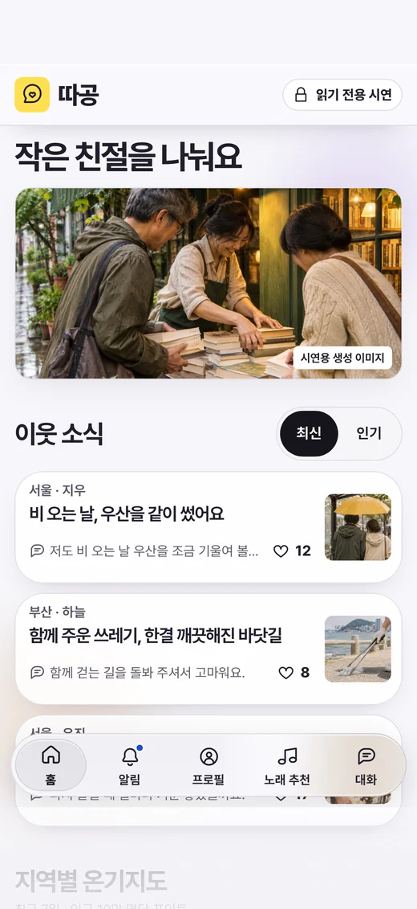
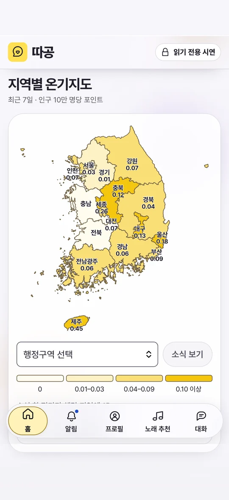
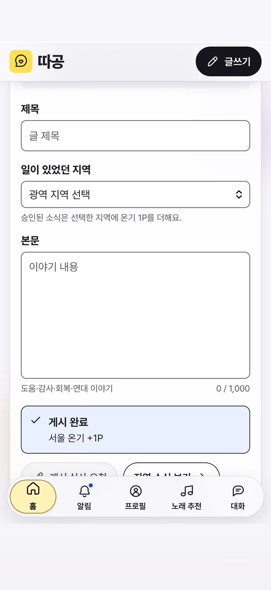

# 따공 · 따뜻한 소식 공유

노래를 들으며 따뜻한 이야기를 접한 날, 마음이 편안해지고 사람에게 정이 가는 기분이 들었습니다. 문득 세상에는 아무도 모르게 작은 친절을 실천하는 사람들이 많겠다는 생각이 들었습니다. 따공은 그 이야기를 나누고 싶어서 시작한 동네 소식 서비스입니다.

**혼자 뿌듯함을 느끼지 말고 나누세요~**


*iPhone 17 Pro 시뮬레이터 Safari에서 촬영한 따공 시연.*

| 바로가기 | 내용 |
| --- | --- |
| [Vercel 공개 시연](https://daily-warming.vercel.app/) | 로그인 없이 다섯 탭과 예시 콘텐츠 탐색 |
| [로컬 실행](#로컬-실행) | Codex의 글·노래 추천 심사와 브라우저 저장 |
| [상세 기획 보고서](docs/planning-report.md) | 개발 목적, 사용자 흐름, 검증 및 후속 실험 |
| [1분 발표 대본](docs/pitch.md) · [SNS UX 비교](docs/social-ux-audit.md) | 발표 화면과 멘트 · 54개 서비스의 설계와 따공 적용 |
| [행사 안내](https://luma.com/p8l79x8m) · [데이터와 에셋](NOTICE.md) | Codex Community Hackathon – Seoul · 지도, 사진과 글꼴 출처 |

## 우리가 함께 나누고 싶은 이야기

퇴근길에 비가 내렸습니다. 지우는 우산 없이 정류장으로 걸었고, 옆 사람이 우산을 조금 기울여 주었습니다. 집에 돌아온 지우는 그날의 고마움을 글에 남겼습니다. 따공의 가상 시연에서 소담은 이 이야기에 “저도 비 오는 날 우산을 조금 기울여 볼게요.”라고 답합니다.

따공에서는 금전 거래 없이 일상의 도움을 기록하고, 그 기억에 따뜻한 응원을 남길 수 있습니다. 오래 기억하고 싶은 이야기를 내 활동으로 돌아보고, 다른 이웃의 글에서 내일 해 볼 작은 일을 찾습니다.

## 시연 동선

홈에서 이야기를 열고, 아래의 온기 지도에서 그 일이 있었던 지역을 고릅니다. 하단의 **홈 · 알림 · 프로필 · 노래 추천 · 대화**로 화면을 전환할 수 있습니다.

| 홈 소식 | 행정구역 온기 지도 |
| --- | --- |
|  |  |
| **노래 추천** | **로컬 게시 심사** |
|  |  |

| 화면에서 하는 일 | 결과 |
| --- | --- |
| 홈에서 **최신** 또는 **인기**를 고르고 카드를 엽니다. | 최대 세 장의 제목, 닉네임, 공감 수와 예시 대표 댓글을 보고 본문을 읽습니다. 인기순은 최근 7일 공감 기준입니다. |
| 홈을 내려 **행정구역 온기지도**에서 지역을 고릅니다. | 16개 시·도의 실제 행정경계 SVG에 개나리색 농도로 포인트를 표시합니다. 지도나 지역 선택 메뉴에서 소식을 열 수 있습니다. |
| 지역에서 **관심 지역 저장**, 프로필에서 **움직임 줄이기**를 선택합니다. | 홈에 해당 지역 소식 바로가기가 생기거나 화면 움직임이 줄어듭니다. 선택한 설정은 이 브라우저에 저장됩니다. |
| **노래 추천**에서 검색하고 **LP 꾸미기**를 엽니다. | 곡에 맞는 추천 이유를 읽고 공식 YouTube 재생 페이지를 엽니다. 음반과 라벨의 색 조합, 라벨 무늬를 곡별로 꾸밀 수 있습니다. |
| 로컬에서 지역 글 또는 노래 추천 글의 심사를 요청합니다. | 승인한 소식을 저장할 때 해당 지역에 1P를 적립합니다. 승인한 노래 추천 글은 해당 LP 카드에 표시됩니다. |

온기 지도는 최근 7일의 지역 포인트를 2026년 10월 말 주민등록인구 **10만 명당**으로 환산합니다. 게시한 첫 이야기부터 1P가 쌓이며, 지역 상세에서 적립 포인트와 환산값을 확인할 수 있습니다. 개나리색이 진할수록 환산값이 높습니다. [행정안전부 인구통계](https://jumin.mois.go.kr/statMonth.do) · [경계와 격자 출처](NOTICE.md)

## 로컬 실행

Node.js 22.18 이상과 npm, Codex CLI를 준비하고 ChatGPT에 로그인합니다.

```bash
git clone https://github.com/Ryu-Jemu/Codex_Community_Hackathon.git
cd Codex_Community_Hackathon
npm ci
codex login status
npm run dev
```

1. [로컬 앱](http://127.0.0.1:5173)에서 **글쓰기**를 엽니다. 제목과 본문, 일이 있었던 광역 지역을 고른 뒤 **게시 심사 요청**을 누릅니다.
2. 승인 예시는 “침수 뒤 이웃들이 가게 정리를 도와주셨어요. 정말 고맙습니다.”입니다. 차단 예시는 “우리 동네 사람들은 다 이기적이고 한심합니다.”입니다. 차단·보류·심사 실패 시 입력을 유지합니다.
3. **노래 추천 → 추천 글 쓰기**에서 그 곡을 추천하는 이유를 500자 이내로 작성합니다. 승인이 완료되면 해당 카드에 글이 표시됩니다.
4. **프로필 → 시연 데이터 초기화**로 이 브라우저의 글과 노래 추천, 공감, 알림 읽음 상태, 예시 대화를 초기화합니다.

제목과 본문의 입력 한도는 각각 UTF-16 코드 단위 100개와 1,000개입니다. 심사에 지역 글의 제목·본문 또는 곡명·추천 이유를 Codex에 전달하므로 시연에는 합성 문장을 사용하세요. 심사는 콘텐츠의 게시 기준을 판단합니다.

## 검증 환경과 시연 범위

- **모바일 검증** · iPhone 17 Pro 시뮬레이터(iOS 26.5) Safari에서 홈 카드와 인기순 전환, 지도에서 지역 글 열기를 확인했습니다. 지역 글의 실제 Codex 승인·차단과 승인 글의 새로고침 후 유지, 노래 추천 글의 승인·카드 표시도 확인했습니다. [검증 기록](docs/planning-report.md#통합-검증-기록)
- **공개 시연** · Vercel에서 예시 콘텐츠를 읽을 수 있습니다. 관심 지역·움직임 설정·LP 디자인은 현재 브라우저에 저장됩니다.
- **로컬 시연** · 승인된 글과 추천, 공감, 알림 읽음 상태, 예시 대화는 현재 브라우저에 저장합니다. 홈의 대표 댓글은 예시 콘텐츠입니다.

## 기대 효과와 후속 실험

흩어져 있던 도움을 동네에서 다시 발견하고, 읽은 이야기가 내일 실천할 작은 행동으로 이어지는 것을 기대합니다. 전국 파일럿에서는 처음 지역 글을 읽은 참여자 중 다음 날부터 7일 안에 같은 지역 글을 다시 연 비율을 봅니다. 감사·응원 댓글, 생활 정보와 무료 나눔·대여를 연결하는 이웃 도움은 그다음 실험입니다. 요청자가 완료를 확인하고 양쪽이 동의하면 감사 글을 공개합니다. 완료 확인에 걸린 시간과 7일 안에 완료된 요청 비율을 살핍니다.

활동 기록은 원하는 사람만 남깁니다. 첫 도움이 확인되면 첫 배지, 서로 다른 이웃 세 명이 각각 완료를 확인하면 다음 배지를 제안합니다. 배지는 기본 비공개이며 본인이 원하는 경우 프로필에 공개합니다. 누구나 배지 없이 도움을 요청할 수 있습니다.

## 개발자 참고

```bash
npm run check
npm test
npm run build
python3 scripts/krmap-tiles.py --check
npm run preview
```

React 19, TypeScript, Vite로 만든 `daily_warming`은 Vercel에서 `npm run build`를 실행해 `dist/`를 배포합니다. 실제 Codex 심사는 `npm run dev`의 로컬 브리지에서 실행합니다.

화면은 반투명 유리 표면, 검은 캡슐 버튼, 노란 아이콘으로 구성했습니다. 책방과 시연 카드 사진은 생성 이미지이며, 글꼴은 Pretendard Variable 1.3.9입니다. [Miro 스타일 참고](https://miro.com/) · [하단 탐색 레퍼런스](https://pin.it/13JHa5dcg) · [에셋과 라이선스](NOTICE.md)
