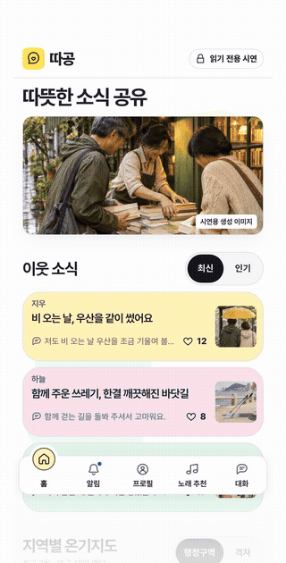
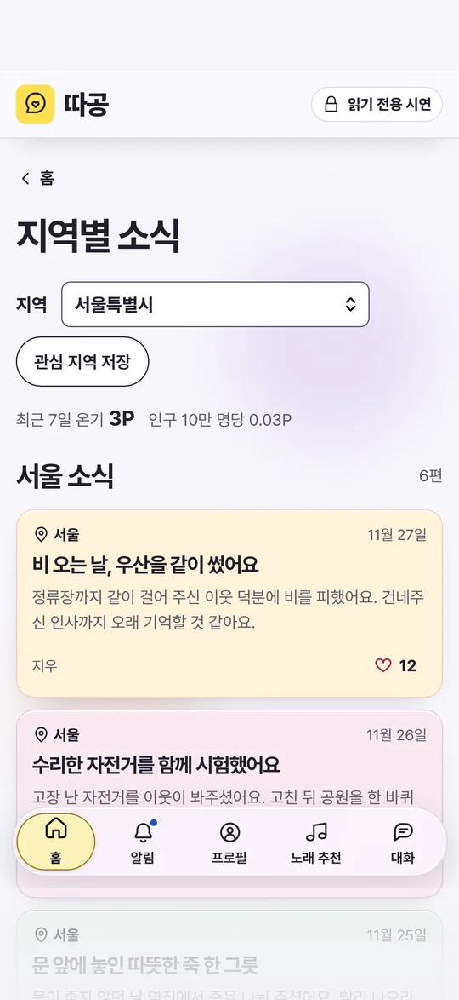
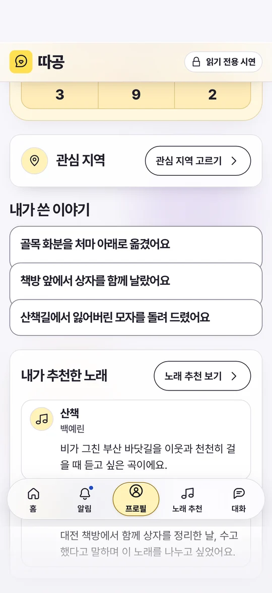
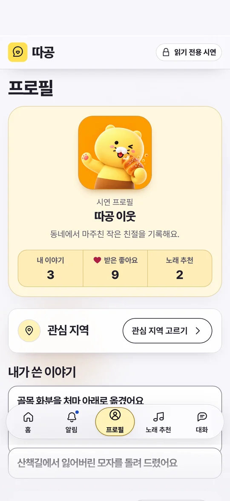
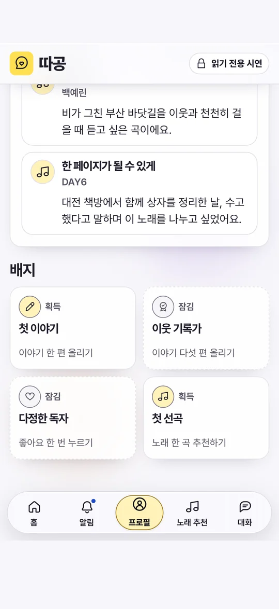
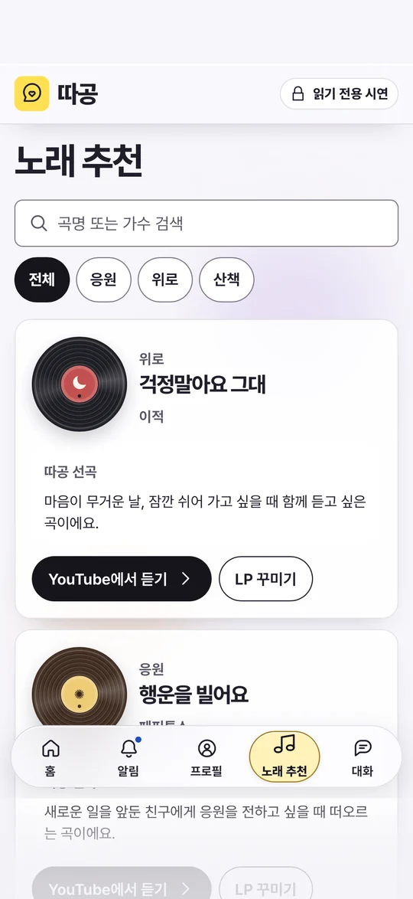
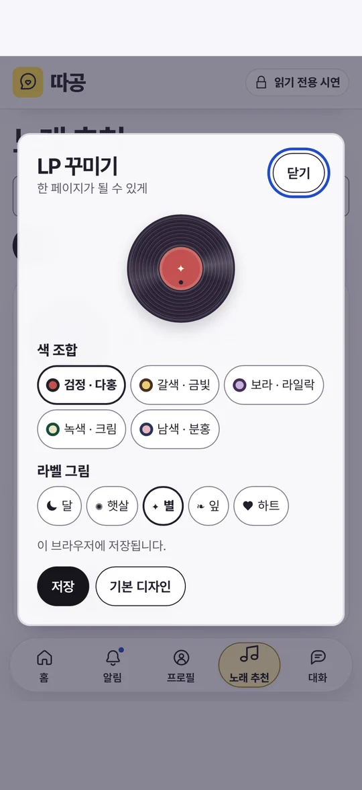
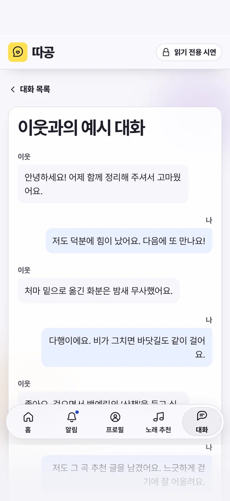

# 따공 · 우리 동네의 따뜻한 소식

이웃이 건넨 작은 친절을 이야기로 남기고, 온기지도에서 우리 동네의 소식을 다시 찾아 읽는 곳입니다.

[로그인 없이 따공 둘러보기](https://daily-warming.vercel.app/) · [1분 발표 대본](docs/pitch.md)

## 우산을 기울여 준 사람이 기억에 남는 날

노래를 들으며 따뜻한 이야기를 접한 날, 마음이 편안해지고 사람들에게 정이 가는 기분이 들었습니다. 문득 우리가 매일 오가는 길에서도 누군가의 하루를 바꾼 작은 친절이 감사 인사 한마디와 함께 지나가겠다는 생각이 들었습니다. 그 장면들을 이웃과 나누고 싶어 따공을 만들었습니다.

따공의 예시 이야기에서 지우는 비 오는 퇴근길에 이웃과 우산을 같이 씁니다. 정류장까지 짧은 거리였지만, 집에 와서도 그날의 인사가 생각나 글로 남깁니다. 소담은 그 글을 읽고 “저도 비 오는 날 우산을 조금 기울여 볼게요.”라고 답합니다. 이처럼 한 사람이 남긴 고마움이 다른 사람에게 내일 해 볼 일을 떠올리게 하길 바랍니다.

> 혼자 뿌듯함을 느끼지 말고 나누세요~

따공에선 고마웠던 일을 기록하고 응원과 선곡을 나눕니다. 포인트는 동네의 이야기 활동을 보여 주고, 배지는 내가 한 일을 돌아보게 해 줍니다. 금전 거래 기능은 없습니다.



## 따공에서 만나는 이야기

- **가까운 곳에서 무슨 일이 있었는지 읽어요.** 홈에서 최신·인기 소식을 최대 세 편씩 보고, 예시 응원 댓글을 읽을 수 있습니다. 온기지도에서 지역을 고르면 16개 시·도의 예시 이야기 94편을 지역마다 5~7편씩 읽을 수 있습니다. 지역 카드에는 다섯 가지 부드러운 색을 번갈아 씁니다. 관심 지역을 저장해 두면 홈과 프로필에서 그 지역 소식으로 바로 갈 수 있습니다.
- **이야기 한 편이 동네에 온기 한 점을 더해요.** 로컬 시연에서 Codex의 게시 기준 심사를 통과한 이야기 한 편마다 해당 지역에 1P가 쌓입니다. 지도는 전남광주통합특별시를 포함한 실제 행정경계를 사용하며, 최근 7일의 포인트를 주민등록 인구 10만 명당으로 환산해 개나리색 농도로 보여 줍니다. 지역 화면에서 최근 포인트와 환산값을 함께 볼 수 있습니다. [행정안전부 주민등록 인구통계](https://jumin.mois.go.kr/statMonth.do)
- **내가 남긴 글과 선곡을 한곳에서 다시 만나요.** 시연 프로필에서 작성한 이야기의 제목을 눌러 본문을 열고, 아래에서 **첫 이야기**, **이웃 기록가**, **다정한 독자**, **첫 선곡** 배지와 달성 조건을 볼 수 있습니다. 로컬에서 이야기에 좋아요를 누르거나 배지를 처음 달성하면 알림이 남습니다.
- **오늘의 마음에 어울리는 노래를 찾아요.** 노래 추천에서 다섯 곡을 검색하고 이웃이 남긴 추천 이유를 읽습니다. 마음에 드는 곡은 공식 YouTube에서 들을 수 있습니다. 곡마다 LP의 색과 라벨 무늬를 꾸며 이 브라우저에 저장할 수 있습니다.

## 처음 만나는 사람에게 보여 줄 세 장면

1. **홈 → 우산 이야기.** 본문과 예시 응원 댓글을 이어서 읽습니다.
2. **온기지도 → 우리 동네.** 지역을 눌러 이야기를 둘러보고, 다시 방문하고 싶다면 관심 지역으로 저장합니다.
3. **프로필과 노래 추천.** 포개진 글 제목과 배지를 살펴보고, 이어서 오늘 듣고 싶은 노래 한 곡의 추천 이유를 읽습니다.

우리 동네의 이야기가 궁금한 사람, 최근 받은 도움을 기억하고 싶은 사람과 시작합니다. 함께 읽고 싶은 이웃에게 마음에 남은 글의 제목과 따공 주소를 보내 보세요. [따공 주소](https://daily-warming.vercel.app/)

| 홈 소식 | 행정구역 온기지도 |
| --- | --- |
|  |  |
| **지역 소식** | **내 이야기 카드** |
|  |  |
| **시연 프로필** | **프로필 하단 배지** |
|  |  |
| **노래 추천** | **LP 꾸미기** |
|  |  |
| **예시 대화** | **로컬 게시 심사** |
|  |  |

*iPhone 17 Pro 시뮬레이터 Safari에서 촬영한 따공 시연.*

**공개 시연**의 예시 콘텐츠는 읽기 전용입니다. 관심 지역과 LP 디자인은 현재 브라우저에 저장할 수 있습니다. **로컬 시연**에서는 새 소식과 추천의 실제 Codex 게시 심사, 좋아요·배지 알림과 예시 대화 답장을 체험합니다. 승인된 글과 시연 활동은 현재 브라우저에 저장됩니다.

## 첫 방문을 부르는 한 편

지역 커뮤니티와 동아리에는 친절을 담은 예시 이야기 한 편과 따공 주소를 함께 소개할 계획입니다. 첫 방문에서는 자기 지역 글 한 편을 읽어 보게 하고, 다시 오고 싶은 독자는 관심 지역을 저장할 수 있게 했습니다.

> 비 오는 날, 우산을 조금 기울여 준 사람을 기억하나요? 우리 동네에도 그런 이야기가 있어요.

## 이웃이 다음에도 돌아오는지 살펴봅니다

따공을 통해 평소 지나치던 도움을 다시 알아보고, 읽은 이야기를 떠올려 작은 행동 하나를 해 보는 사람이 생기기를 기대합니다. 첫 전국 파일럿에서는 지역 글을 처음 읽은 사람 중 **다음 날부터 7일 안에 같은 지역의 글을 다시 연 사람의 비율**을 봅니다.

그다음에는 감사·응원 댓글과 생활 정보·무료 나눔·대여를 연결하는 이웃 도움을 실험합니다. 요청을 올린 사람이 등록 후 7일 안에 도움 완료를 확인한 비율을 살펴보고, 양쪽이 동의한 경우에 감사 글을 남기는 흐름을 검증합니다. [상세 기획 보고서](docs/planning-report.md)

<details>
<summary>개발자 참고 · 로컬 실행과 검증</summary>

Node.js 22.18 이상, npm 및 ChatGPT에 로그인한 Codex CLI가 필요합니다.

```bash
git clone https://github.com/Ryu-Jemu/Codex_Community_Hackathon.git
cd Codex_Community_Hackathon
npm ci
codex login status
npm run dev
```

[로컬 앱](http://127.0.0.1:5173)에서 **글쓰기 → 게시 심사 요청**으로 소식을 제출하거나 **노래 추천 → 추천 글 쓰기**로 선곡 이유를 남깁니다. 시연에는 합성 문장을 사용하세요. 심사 시 소식의 제목·본문 또는 곡명·추천 이유가 Codex에 전달됩니다. **프로필 → 시연 데이터 초기화**로 브라우저의 시연 활동을 되돌릴 수 있습니다.

```bash
npm run check
npm test
npm run build
python3 scripts/krmap-tiles.py --check
```

React 19, TypeScript, Vite 기반입니다. Vercel은 `npm run build`의 `dist/`를 배포하며, Codex 심사는 개발 서버에서 실행합니다. [통합 검증 기록](docs/planning-report.md#통합-검증-기록) · [54개 SNS UI·UX 비교](docs/social-ux-audit.md) · [지도·이미지·글꼴 출처](NOTICE.md) · [행사 안내](https://luma.com/p8l79x8m)

</details>
